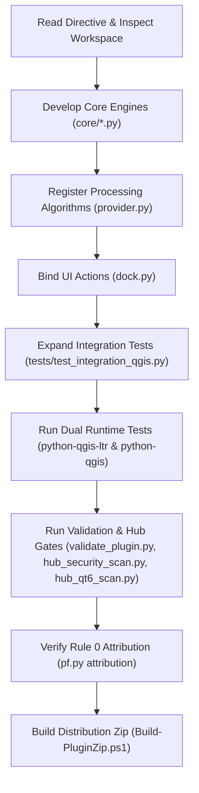

# NEXT_AGENT_MASTER_DIRECTIVE.md — PlanX MPYY Studio
## Canonical Autonomous Specification & Next-Generation Architecture Directive

> **DOCUMENT STATUS:** Authoritative / Ready for Autonomous Execution  
> **TARGET PLUGIN:** `planx_mpyy_studio` (PlanX MPYY Studio)  
> **ROOT PATH:** `C:\Users\YE\PyCharmMiscProject\qgis_plugins\planx_mpyy_studio`  
> **AUTHOR & SOLE CONTRIBUTOR:** Yusuf Eminoğlu (`yusuf.eminoglu@deu.edu.tr`)  
> **QGIS TARGET RUNTIMES:** QGIS 3.44 LTR (`C:\OSGeo4W\bin\python-qgis-ltr.bat`) & QGIS 4.2 (`C:\OSGeo4W\bin\python-qgis.bat`)  
> **CURRENT MILESTONE:** `2.5.2` (Verified Turkish presentation: 83 algorithms, 126 tests PASS on both runtimes, Hub security CLEAN, Qt6 CLEAN, 0 warnings)  
> **NEXT DEVELOPMENT PRIORITIES:** edge-based network snapping and explicit transfer-location controls

---

## 1. Executive Briefing for the Downstream AI Agent

You are receiving this document because you have been tasked with taking **PlanX MPYY Studio** from its production-ready `1.0.0` foundation into its next major architectural evolution.

This repository is part of a 24-plugin urban planning monorepo. Each plugin is physically isolated in its own directory, with its own tests, its own git repository, and its own metadata, governed globally by `plugins.toml` and verified by `packaging/pf.py`.

Your task is to **read this directive completely**, understand the existing architecture, and execute the specified next-generation capabilities, algorithms, performance engines, and test cases **autonomously in one pass**, while maintaining 100% compliance with every project invariant.

---

## 2. Non-Negotiable Project Invariants (The Five Iron Rules)

Every change you make MUST adhere strictly to these rules. Failure to comply with even one rule blocks the QGIS Plugin Hub upload permanently:

### Rule 0 — Attribution is Absolute
- **No AI is ever credited as a contributor. Ever.**
- Every commit, docstring, header, and author field must reflect **Yusuf Eminoğlu** (`yusuf.eminoglu@deu.edu.tr`) alone.
- Never write `Co-Authored-By:`, "Generated with...", bot signatures, or AI-looking commit metadata.
- Local git hooks (`core.hooksPath = packaging/githooks`), GitHub Actions workflows (`no-ai-attribution`), and `py -3 packaging/pf.py attribution` strictly enforce this.

### Rule 1 — Zero Bandit B110 Violations (Hub Security Blocker)
- **`try/except: pass` permanently blocks a plugin version on the QGIS Hub.**
- Bandit flags B110/B112. `# nosec` DOES NOT WORK on the Hub.
- Always use `contextlib.suppress(...)` instead of bare `except: pass`:
  ```python
  import contextlib
  with contextlib.suppress(Exception):
      do_something_optional()
  ```
- All random calls must use standard random unless cryptographic security is required; avoid `eval()`, `exec()`, `shell=True` subprocesses, or hardcoded credentials.

### Rule 2 — Absolute Prohibition of `%` in `metadata.txt`
- The QGIS Plugin Hub uses Python's standard `configparser` without escaping.
- A literal `%` character anywhere in `metadata.txt` (including changelog, description, or about) **crashes the Hub parser with an InterpolationSyntaxError** and blocks the upload.
- Write `30 percent` instead of a literal percent sign in metadata.

### Rule 3 — Dual Runtime Verification (QGIS 3.44 LTR & QGIS 4.2)
- All Python code and tests must execute cleanly without deprecation crashes or syntax errors on **both**:
  - `C:\OSGeo4W\bin\python-qgis-ltr.bat` (Python 3.12, Qt5/PyQt5, QGIS 3.44 LTR)
  - `C:\OSGeo4W\bin\python-qgis.bat` (Python 3.12+, Qt6/PyQt6, QGIS 4.2)
- Do not use bare `Qt.LeftButton`, `Qt.Key_*`, or `Qt.*Modifier` directly without safe shims or PyQt abstractions.
- All test suites must be executable headlessly via `-m planx_mpyy_studio.tests.<suite_name>`.

### Turkish Interface Copy
- All plugin-owned GUI, Processing metadata, help, messages, attribute forms, legends, MapTips and generated report text must be Turkish. The user explicitly changed the language requirement for this plugin; this overrides the root English-only default.
- Keep statutory codes, source catalog identities, field names and user-supplied names intact; use `core/localization.py` and the reviewed display-label sidecar for presentation.

### Rule 4 — Monorepo Integrity & Packaging
- Plugin directory name == zip root name == Python package name (`planx_mpyy_studio`). No dashes or spaces.
- The single source of truth for plugin metadata, release branches, and test commands is `plugins.toml`.
- Every new Processing algorithm must be registered in `provider.py` inside `PlanXMPYYProvider.loadAlgorithms()`.
- Package building is handled exclusively via `packaging/Build-PluginZip.ps1`.

---

## 3. Current Architecture & State of the Art (Milestone 2.4.0)

Profile identities are implemented in `core/profile_identity.py` and exposed by `audit_mpyy_schema_profile_identity`. Embedded canonical identities, optional independent digest pins, source-byte identities and dictionary reconstruction are distinct checks. GeoPackage audits reject a changed imported profile before schema inspection, while unsigned legacy profiles remain supported. JSON profile and mapping readers reject duplicate keys and non-finite values. Issuer authenticity is explicitly unverified.

The multimodal engine now builds incoming arcs directly and stores immutable shared mode tails instead of copying every full route sequence into each search state. It caches rendered mode text for requested demand routes and checks cancellation throughout analysis. The two-scenario synthetic benchmark in `tests/benchmark_accessibility_qgis.py` preserved exact reference results. On the 6,000-edge fixture, Python traced peak memory fell from about 167 MB to 6.7 MB on both target runtimes. Raw single-run measurements and the retained 2.3.0 reference are under `scratch/mpyy_240` at the plugins root. Tracing excludes native QGIS/GEOS memory and adds timing overhead.

The four registered test modules contain 108 tests, all passing on both runtimes. This milestone adds one algorithm and eight regression tests. Connectivity still requires shared vertices, and demand/facility snapping is still to vertices. Transfer penalties apply to every network mode change; there is currently no explicit transfer-stop restriction.

The CSV dictionary adapter is in `core/schema_profile_import.py`, and paired network/facility scenario comparison is in `core/accessibility_scenarios.py`. Both are registered in Processing and bound to dock actions. The importer preserves explicitly declared institution/reference metadata, source and profile SHA-256 identities, and column mappings; it does not independently authenticate the issuer. The GeoPackage audit now enforces declared primary-key requirements. Directed multimodal search uses incoming arcs from destinations, and reported mode sequences follow demand-to-facility travel order. Shared scenario layers must use a projected CRS in metres. Network connectivity still requires shared vertices, and demand/facility snapping is to vertices rather than arbitrary positions on edges.

The five existing PlanX-adapted urban analysis tools (building morphology, Spacematrix density, street network morphology, declared plan-metric scenario comparison, and accessibility equity) are included and documented in 2.3.0. The four registered test modules contain 100 tests in total; `tests/test_scenarios_profiles_qgis.py` adds ten regression tests. Full `pf verify` passes on both runtimes. Local attribution and registry drift audits are clean. The GitHub contributor checks were unavailable in this session; this plugin has no remote and no commits.

Before modifying the codebase, understand the existing layout and components in `planx_mpyy_studio`:

```text
planx_mpyy_studio/
├── __init__.py                  # Plugin entry point: classFactory(iface)
├── main_plugin.py               # PlanXMPYYStudioPlugin lifecycle & QGIS UI actions
├── dock.py                      # Interactive right-dock panel with 8 tabbed workflow studios
├── provider.py                  # QgsProcessingProvider with 83 registered algorithms
├── metadata.txt                 # Hub metadata (version=2.4.0, 0 percent characters)
├── resources.py                 # Compiled Qt resources
├── core/
│   ├── gpkg_manager.py          # SQLite/GPKG schema generator (UIP standards, tables, views)
│   ├── styler.py                # Native QGIS symbology applier (.qml & categorized rules)
│   ├── form_designer.py         # Tabbed form layouts & conditional visibility expressions
│   ├── synthesis.py             # O(N log M) spatial parcel density & building analysis
│   ├── dop_engine.py            # 3194 s. Kanun Md. 18 DOP calculation & %45 threshold checks
│   ├── allocation_engine.py     # Md. 18 Land readjustment distribution matrix & share table
│   ├── feasibility_engine.py    # 6306 s. Kanun Urban transformation entitlement & financial balance
│   ├── capacity_engine.py       # PAİY Md. 5 & 29 non-FAR (%30 emsal harici) capacity engine
│   ├── qc_engine.py             # Plan geometry QC & Law 7221 "Yençok: Serbest" height audit
│   ├── geom_cleaner.py          # Topological boundary auto-healing & snapping
│   ├── zoning_certificate.py    # İmar Çapı HTML generator & CAD HUD setback memory layer
│   ├── plan_diff.py             # Plan revision difference engine with Md. 26 service radius lookups
│   ├── pafta_index.py           # Standard Turkish map sheet (pafta) grid generator
│   └── report_engine.py         # Unified HTML/Markdown export engine
├── tests/
│   ├── test_database_qgis.py    # 6 database & schema tests
│   ├── test_styler_qgis.py      # 5 symbology & style rule tests
│   └── test_integration_qgis.py # 32 end-to-end processing & engine integration tests
└── styles/                      # QML styles, palettes, and SVG symbols
```

### Historical 1.0.0 Inventory (superseded by the 60-algorithm provider)
1. `planx_mpyy:create_workspace` — Creates a standardized UIP GeoPackage workspace with official spatial tables.
2. `planx_mpyy:apply_styles` — Applies official Turkish planning color codes and symbology to active layers.
3. `planx_mpyy:configure_forms` — Configures tabbed attribute edit forms with conditional field visibility.
4. `planx_mpyy:synthesize_parcel_density` — Accelerates parcel-building overlay using `QgsSpatialIndex`.
5. `planx_mpyy:calculate_dop` — Evaluates Düzenleme Ortaklık Payı (DOP) and checks against the %45 legal ceiling.
6. `planx_mpyy:generate_land_readjustment_matrix` — Solves cadastral-to-zoning land reallocation matrix (Tahsis Matrisi).
7. `planx_mpyy:evaluate_transformation_feasibility` — Evaluates 6306 s. Kanun urban renewal financial and area feasibility.
8. `planx_mpyy:calculate_zoning_capacity` — Computes KAKS, TAKS, and PAİY Md. 5 %30 non-FAR building envelope capacities.
9. `planx_mpyy:generate_zoning_certificate` — Produces an official İmar Durumu Belgesi (HTML + CAD HUD layer).
10. `planx_mpyy:run_plan_qc` — Performs geometric auditing and Law 7221 "Yençok: Serbest" height prohibition checks.
11. `planx_mpyy:clean_planning_geometries` — Snaps boundaries and auto-heals micro-gaps and slivers between zoning polygons.
12. `planx_mpyy:compare_plan_revisions` — Compares baseline vs. revised plans with Md. 26 equivalent social amenity audits.
13. `planx_mpyy:generate_pafta_grid` — Creates national standard 1/1000, 1/5000, 1/25000 pafta sheet grids.
14. `planx_mpyy:export_spatial_summary` — Aggregates land use areas by category and calculates urban density indices.
15. `planx_mpyy:import_cad_plan` — Imports DXF/DWG files and normalizes layers to UIP feature specifications.
16. `planx_mpyy:export_uip_exchange` — Packages project layers into a portable, compliant UIP exchange bundle.
17. `planx_mpyy:validate_plan_notes` — Audits plan notes against mandatory planning regulations and keywords.
18. `planx_mpyy:calculate_solar_envelope` — Computes solar rights and shading envelopes across adjacent building parcels.
19. `planx_mpyy:batch_clean_parcels` — Cleans duplicate vertices, self-intersections, and spikes across cadastral boundaries.
20. `planx_mpyy:generate_road_centerlines` — Derives centerline networks and calculates street widths from zoning road polygons.
21. `planx_mpyy:audit_social_amenities` — Compares provision of schools, health, parks against Mekânsal Planlar Yapım Yönetmeliği standards per capita.
22. `planx_mpyy:generate_demographic_projection` — Models future population scenarios based on zoning floor area capacities.
23. `planx_mpyy:export_plan_web_map` — Generates a lightweight standalone Leaflet/OpenLayers HTML web map.
24. `planx_mpyy:extract_plan_boundaries` — Extracts exterior municipal and plan boundary polygons with vertex sequencing.
25. `planx_mpyy:generate_slope_aspect_zones` — Analyzes DEM rasters to classify terrain slope suitability for construction.
26. `planx_mpyy:audit_geotechnical_suitability` — Overlays zoning boundaries with geological hazard zones (Heyelan, Fay, Taşkın).

---

## 4. Work Packages for the Next Agent (Target Milestone 1.1.0 / 2.0.0)

As the downstream agent, you are tasked with executing the following high-value work packages. Each work package contains exact algorithmic requirements, formulas, and integration instructions.

### Work Package A: Algorithmic Parcel Subdivision & Amalgamation Engine (Tevhid & İfraz Optimizasyonu)
- **Goal:** Provide automated, mathematically optimized parcel subdivision (İfraz) and amalgamation (Tevhid) adhering strictly to Planlı Alanlar İmar Yönetmeliği (PAİY) Madde 7, 8 and 9.
- **Engine File:** Create `planx_mpyy_studio/core/subdivision_engine.py`.
- **Key Algorithmic Requirements:**
  1. **Minimum Parcel Parameter Matrix (PAİY Md. 7):**
     - *Konut / Ticaret:*
       - Ayrık Nizam: Min Cephe = $12.0m$, Min Derinlik = $18.0m$, Min Alan = $500m^2$
       - Bitişik Nizam: Min Cephe = $6.0m$ (3 kata kadar) / $9.0m$ (4+ kat), Min Derinlik = $14.0m$
       - Blok Nizam: Min Cephe = $18.0m$, Min Derinlik = $18.0m$
     - *Sanayi / Küçük Sanayi:* Min Cephe = $20.0m$, Min Derinlik = $30.0m$, Min Alan = $2000m^2$
  2. **Spine-Bisection Partitioning Algorithm:**
     - Given an irregular zoning block or large parcel, compute its Oriented Minimum Bounding Box (OMBB).
     - Identify the primary road frontage edge using spatial intersection with adjacent road features.
     - Subdivide the polygon along vectors perpendicular to the road frontage at intervals equal to the target parcel width, ensuring resulting parcels meet or exceed minimum depth and area thresholds.
     - Any residual sliver parcel below legal minimums must be algorithmically merged with the adjacent parcel possessing the shortest shared boundary (PAİY Md. 9 Tevhid kuralı).
  3. **Data Structures:**
     ```python
     @dataclass
     class SubdivisionConstraint:
         nizam: str
         min_frontage: float
         min_depth: float
         min_area: float
         max_parcels: int = 100

     @dataclass
     class SubdivisionResult:
         source_parcel_id: str
         generated_parcels_count: int
         total_original_area: float
         subdivided_geometries: list[QgsGeometry]
         warning_notes: list[str]
     ```
  4. **Processing Algorithm:** Register `planx_mpyy:optimize_parcel_subdivision` in `provider.py`.

---

### Work Package B: Automated Municipal Print Atlas & Official Layout Engine (`QgsPrintLayout` Automation)
- **Goal:** Provide headless, pixel-perfect generation of official municipal İmar Durumu Belgesi and Parselasyon Dosyası PDF sheets.
- **Engine File:** Create `planx_mpyy_studio/core/print_atlas_engine.py`.
- **Key Algorithmic Requirements:**
  1. **Dynamic `QgsPrintLayout` Assembly:**
     - Create a clean `QgsPrintLayout(project)` targeting A3 landscape ($420 \times 297 mm$) or A4 portrait ($210 \times 297 mm$).
     - Add `QgsLayoutItemMap` centered on the target parcel with a configurable buffer ($20m - 50m$).
     - Add `QgsLayoutItemScaleBar` bound to the map item (metric units, segment intervals auto-calculated).
     - Add `QgsLayoutItemPicture` with standard North Arrow SVG (`svgMarkers/north_arrow.svg`).
     - Add an official Municipal Approval Stamp Box (Belediye Onay ve Mühür Bloğu) with:
       - Belediye Adı, Fen İşleri / İmar ve Şehircilik Müdürlüğü başlığı
       - Tasdik Eden / Onaylayan Şehir Plancısı imza çizgisi
       - Tarih ve Belge Sayı alanı
     - Add a dynamic Attribute & Parameter Table (Ada, Parsel, Alan, KAKS, TAKS, Hmax, Çekme Mesafeleri, Hukuki Açıklamalar).
     - Add an SHA-256 digital document verification hash and QR code placeholder box.
  2. **Export Capabilities:** Export to PDF (`layout.exporter().exportToPdf(...)`) or high-res GeoTIFF/PNG ($300 \text{ DPI}$).
  3. **Processing Algorithm:** Register `planx_mpyy:export_official_zoning_atlas` in `provider.py`.

---

### Work Package C: 3D Procedural Building Envelope & Massing Engine (Masif Hacim & Çatı Gabarisi)
- **Goal:** Generate true 3D geometry building massing envelopes (`PolygonZ` / `MultiPolygonZ`) directly from 2D zoning parameters for urban visualization and volumetric density analysis.
- **Engine File:** Create `planx_mpyy_studio/core/massing_engine_3d.py`.
- **Key Algorithmic Requirements:**
  1. **Volumetric Extrusion Calculations (PAİY Madde 28, 35, 40):**
     - Base Level: $Z_{0} = \text{Subbasement Height (Su Basman Kotu)}$ (default $+0.50m$ to $+1.00m$).
     - Ground Floor: Commercial / Residential typical height ($h_{\text{zemin}} = 3.50m - 4.50m$).
     - Typical Floors: $N = \lfloor (H_{\text{azami}} - h_{\text{zemin}}) / 3.00m \rfloor$.
     - Setback Attic (Çatı Katı): If roof slope is permitted, generate a setback attic envelope angled at $33\%$ or $45\%$ from the building perimeter parapet.
  2. **Geometry Generation:**
     - Take the 2D setback envelope polygon generated by `ZoningCertificateEngine.calculate_setback_envelope`.
     - Construct 3D prisms using `QgsGeometry.fromWkt(...)` or `QgsPolygon` with Z-coordinates representing floor slabs, facades, and roof pitch.
     - Calculate gross volume ($m^3$) and space efficiency ratio ($\text{Volume} / \text{Parcel Area}$).
  3. **Processing Algorithm:** Register `planx_mpyy:generate_procedural_3d_massing` in `provider.py`.

---

### Work Package D: Metropolitan Municipal By-Law Overrides Engine (Büyükşehir İmar Yönetmelikleri)
- **Goal:** Turkish municipalities (Istanbul, Ankara, Izmir, Bursa, etc.) have local zoning by-laws (Büyükşehir İmar Yönetmelikleri) that override or tighten PAİY baseline rules.
- **Engine File:** Create `planx_mpyy_studio/core/bylaw_engine.py`.
- **Key Algorithmic Requirements:**
  1. **Rule Configuration Registry:**
     - Store regional rule profiles in an internal dictionary or JSON resource (`resources/bylaws/`):
       - `PAIY_DEFAULT`: Baseline Planlı Alanlar İmar Yönetmeliği.
       - `ISTANBUL_IBB`: İBB İmar Yönetmeliği (e.g. min. tavan yüksekliği $2.80m$, bağımsız bölüm min. net alanı $28.5m^2$, çatı eğimi $\%33$ / $\%45$, otopark parsel içi zorunluluğu).
       - `ANKARA_ABB`: ABB İmar Yönetmeliği (e.g. su basman kotu min $+1.20m$, parsel derinlik oranları).
       - `IZMIR_IBB`: İzmir İmar Yönetmeliği (e.g. saçak ve konsol çıkma kısıtlamaları, açık çıkma kuralları).
  2. **Compliance Auditing:**
     - Check building and parcel attributes against the selected municipality's profile.
     - Flag non-compliant overhangs, insufficient parking allocations, and roof pitch violations.
  3. **Processing Algorithm:** Register `planx_mpyy:audit_municipal_bylaw_compliance` in `provider.py`.

---

### Work Package E: Concurrent Multi-User GeoPackage WAL & Conflict Resolution Engine
- **Goal:** Enable multiple planning team members to edit the same UIP GeoPackage concurrently without database locking crashes or data corruption.
- **Engine File:** Create `planx_mpyy_studio/core/concurrency_engine.py`.
- **Key Algorithmic Requirements:**
  1. **SQLite WAL Optimization:**
     - Enable `PRAGMA journal_mode=WAL;` and `PRAGMA busy_timeout=5000;` on all GeoPackage connections.
  2. **Optimistic Concurrency Control:**
     - Add `uuid_version` and `last_modified_timestamp` tracking fields to all core tables.
     - When reconciling differences between two GeoPackages or branch edits, compare feature geometry hashes and modification timestamps.
     - Non-conflicting edits are merged automatically; intersecting edits with differing attributes generate conflict flags in a `_reconciliation_conflicts` table.
  3. **Processing Algorithm:** Register `planx_mpyy:reconcile_workspace_versions` in `provider.py`.

---

## 5. Implementation & Verification Pipeline

When executing this directive, follow this exact sequence to ensure zero regressions:



### Verification Command Battery
Execute these commands from `PLUGINS_ROOT` (`C:\Users\YE\PyCharmMiscProject\qgis_plugins`):

1. **Metadata Validation:**
   ```powershell
   py -3 packaging/validate_plugin.py planx_mpyy_studio
   ```
   *Expectation:* `VALID: planx_mpyy_studio (0 warnings)`

2. **Hub Security Scan (Blocking):**
   ```powershell
   py -3 packaging/hub_security_scan.py planx_mpyy_studio
   ```
   *Expectation:* `CLEAN: planx_mpyy_studio (0 critical, 0 warnings)`

3. **Qt6 Compatibility Scan (Advisory):**
   ```powershell
   py -3 packaging/hub_qt6_scan.py planx_mpyy_studio
   ```
   *Expectation:* `QT6 CLEAN: 1 plugin(s)`

4. **Rule 0 Attribution Audit:**
   ```powershell
   py -3 packaging/pf.py attribution
   ```
   *Expectation:* `CLEAN: no AI author, committer, co-author trailer or GitHub contributor.`

5. **Dual Runtime Test Verification:**
   ```powershell
   py -3 packaging/pf.py verify planx_mpyy_studio
   ```
   *Expectation:* All suites PASS across both `qgis[ltr]` and `qgis[qgis4]`.

6. **Distribution Zip Packaging:**
   ```powershell
   powershell -ExecutionPolicy Bypass -File packaging/Build-PluginZip.ps1 -PluginDir planx_mpyy_studio
   ```
   *Expectation:* Clean zip written to `QGIS_Plugin_Releases/planx_mpyy_studio.zip`.

---

## 6. Ready-to-Copy Master Prompt for the Downstream AI Agent

If you are handing this file over to another AI agent, copy and paste the prompt below directly into the agent's input window:

```markdown
You are executing the canonical engineering blueprint for PlanX MPYY Studio.

TASK:
Continue the `2.4.0` implementation of `planx_mpyy_studio` by strictly following:
`C:\Users\YE\PyCharmMiscProject\qgis_plugins\planx_mpyy_studio\NEXT_AGENT_MASTER_DIRECTIVE.md`

KEY DELIVERABLES:
1. Treat Work Packages A-E as completed; inspect the existing engines before proposing or implementing additions.
2. Preserve the plan-level audits, evidence provenance, dossier lifecycle, administrative integrity, routed accessibility, adjacency, fabric topology, and MPYY evidence/change audits.
3. Preserve owner-declared freshness policy, profile-driven GeoPackage validation, deterministic dossier inventories, plan-note decision links, version hash chains, multimodal impedance, file containment and identity checks, Article 7 participation and evidence re-evaluation, Article 9/5 mixed-use detail review, Article 32 approval-sheet registration, Article 33 publication chronology, and Articles 34-35 digital delivery integrity.
4. Prefer reproducible report consolidation, large-layer spatial indexing, and explicit uncertainty over invented legal thresholds.
5. Register every new algorithm in `provider.py`, bind it to `dock.py`, and add engine plus Processing regression coverage.
6. Verify everything cleanly passes on both QGIS runtimes (3.44 LTR and 4.2) and through all Hub security and attribution gates:
   - `py -3 packaging/validate_plugin.py planx_mpyy_studio` (0 warnings)
   - `py -3 packaging/hub_security_scan.py planx_mpyy_studio` (CLEAN)
   - `py -3 packaging/hub_qt6_scan.py planx_mpyy_studio` (CLEAN)
   - `py -3 packaging/pf.py attribution` (CLEAN)
   - `py -3 packaging/pf.py verify planx_mpyy_studio` (VERIFY OK)
   - `powershell -ExecutionPolicy Bypass -File packaging/Build-PluginZip.ps1 -PluginDir planx_mpyy_studio` (Builds zip cleanly)

STRICT INVARIANTS:
- Rule 0: Sole attribution is Yusuf Eminoğlu (yusuf.eminoglu@deu.edu.tr). Zero AI co-authorship.
- Zero Bandit B110 violations (use contextlib.suppress, never bare except: pass).
- Zero '%' characters in metadata.txt.
- Execute everything autonomously, meticulously, and in one go.
```
